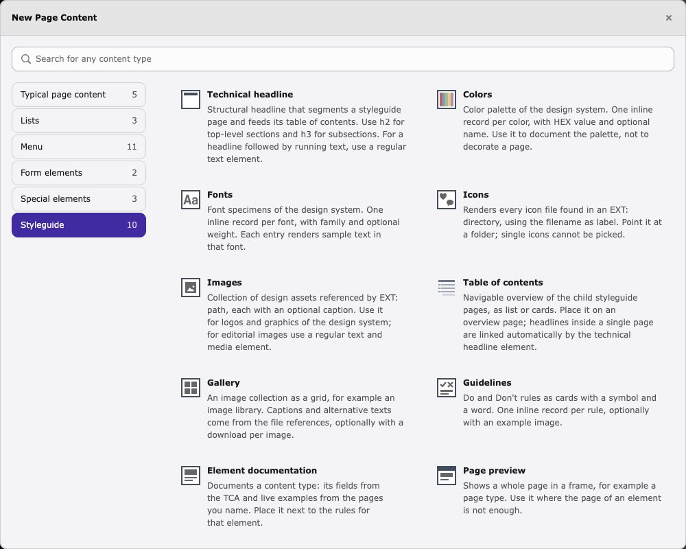

# Content Elements

This extension provides the following content elements for building a styleguide:

- [Technical Headline](#technical-headline)
- [Colors](#colors)
- [Fonts](#fonts)
- [Icons](#icons)
- [Images](#images)
- [Table of Contents](#table-of-contents)
- [Gallery](#gallery)
- [Guidelines](#guidelines)
- [Element Documentation](#element-documentation)

> [!TIP]
> All styleguide content elements are only available on the custom [Styleguide page type](PageType.md) and grouped under a dedicated **Styleguide** tab in the New Content Element wizard.

##  Technical Headline

The `Technical Headline` content element creates a structural headline for your styleguide.

> [!TIP]
> It automatically generates a table of contents for all technical headlines within the page, which can be used to navigate through the document.

Use the `Headline-Level` attribute to change the hierarchy of the headline. The default is `h2`, but you can also use `h3` or `h4`. A rich text field is available for additional body text below the headline.

##  Colors

The `Colors` content element displays a color palette. Each color is defined as an inline record with:

- **Color** — HEX color value (e.g. `#EAE7E2`)
- **Label** — Optional name for the color (e.g. "cararra")
- **CMYK**, **PMS**, **Variable name** — Optional values for the Detail layout (e.g. `0, 72, 100, 0`, `PANTONE 165 C`, `$color-primary`)
- **Role** — Optional `Success`, `Warning` or `Error`, shown as a symbol in the Status layout

Colors are rendered as swatches with their HEX value and label.

Choose the **Layout** to change the output:

- **Swatches** — The default, one square swatch per color
- **Detail** — One card per color with HEX, RGB (calculated from the HEX value), the optional CMYK, PMS and variable name, and a contrast check. HEX, RGB and the variable name are copy buttons
- **Scale** — All colors of the element as one row of steps, for example the tints of a main color. Without a label, the steps are numbered `01`, `02` and so on
- **Status** — One card per color with its symbol, name, HEX, RGB and the contrast check. Use it with the roles, so a status never relies on color alone

The Detail and Status layouts add a rich text field for usage rules above the colors, for example when a color is meant for text, surfaces or accents. For the contrast check, each color is compared to a light and a dark text color (default `#FFFFFF` and `#000000`, adjustable per element) and gets the WCAG level it reaches: `AAA`, `AA`, `Large text only` or `Not for text`. The level is always written out, never conveyed by color alone.

##  Fonts

The `Fonts` content element showcases available fonts. Each font is defined as an inline record with:

- **Font** — Font family name (e.g. `Lexend`)
- **Font Weight** — Optional weight value (e.g. `700`)
- **Label** — Optional display name
- **Usage** — Optional purpose of this weight for the Detail layout (e.g. "Headlines")

Each font entry renders a specimen text in the specified font family and weight.

Choose the **Layout** `Detail` for one specimen per element instead: a large "Aa", the alphabet and digits in the first font, an optional sample text and a table of all weights with their usage. A CSS snippet with a copy button is generated from the first font. Further fields of the Detail layout:

- **Fallback fonts** — Appended to the font family in the snippet and the specimen, e.g. `'Segoe UI', sans-serif`
- **Sample text** — Optional line below the alphabet
- **Download link** — Optional link to the font files
- **Note** — Rich text above the weights, e.g. how the font is hosted

Enter the font family as you would in CSS, including quotes or a stack where needed, because the value is used as it is.

##  Icons

The `Icons` content element displays all icon files from a given directory. Configure it with:

- **Path** — An `EXT:` path pointing to the icon directory (e.g. `EXT:sitepackage/Resources/Public/Icons/`)
- **Exclude** — Optional comma-separated list of file name patterns to skip (e.g. `*-alt.svg, legacy-*, *.json`). The wildcards `*` and `?` are supported.

All files in the directory that are not excluded are rendered as icons with their filename as label.

##  Images

The `Images` content element displays a collection of images. Each image is defined as an inline record with:

- **Path** — An `EXT:` path to the image file (e.g. `EXT:sitepackage/Resources/Public/Images/logo.svg`)
- **Caption** — Optional caption text

Enable **Show download links** to add a download link with the original file below each image, for example for logo files.

##  Table of Contents

The `Table of Contents` content element renders a navigable overview of the child pages below the page it is placed on, recursively through all levels. Only pages using the [Styleguide page type](PageType.md) are listed.

- **Layout** — `List` for a nested, indented list, `Cards` for a grouped card grid with one group per page level, or `Areas` for one larger card per direct child page, for example on a start page

> [!TIP]
> In `Cards` and `Areas` layout, each card shows the icon of the child page's **Representative content element** property (set on that page's *Styleguide* tab), if configured.

In `Areas` layout, a card shows the page title, the page's **Subtitle** as a short text, the links to its child pages and an "Open area" button. The titles are third level headings, so give the element a header to keep the heading levels in order.

Place it on an overview page to document the page structure. Headlines within a single page are linked automatically by the [Technical Headline](#technical-headline) element instead.

##  Gallery

The `Gallery` content element shows an image collection as a grid, for example an image library. Select the images as file references, so editors maintain them in the backend.

- **Images** — File references. The alternative text and the description of each reference are used as `alt` and as caption
- **Columns** — 2 to 6 columns on wide screens, reduced to 3 and 2 on narrow screens
- **Show download links** — Adds a download link with the original file below each image

Images load lazily and are scaled to a maximum width of 600 px, the download always delivers the original file.

##  Guidelines

The `Guidelines` content element shows Do and Don't rules as cards. Each rule is defined as an inline record with:

- **Type** — `Do` or `Don't`
- **Text** — The rule
- **Example image** — Optional `EXT:` path to an image that shows the rule

Every card carries a symbol and a word, so a rule never relies on color alone. The example image has no alternative text of its own, because the rule text describes it.

##  Element Documentation

The `Element Documentation` content element documents a content type, for example one of your own or a Content Block. Pair it with a [Guidelines](#guidelines) element for the Do and Don't rules.

- **Content type** — The type to document
- **Example pages** — Up to ten pages that hold example elements of this type
- **Description** — Optional rich text above the preview

It renders two parts:

- **Preview** — Every element of the chosen type on the example pages, rendered live. The name above each example is the last [Technical Headline](#technical-headline) before it on that page. Three buttons set the width of the preview boxes to 1200, 768 and 375 px
- **Fields** — The fields an editor fills in, with their label, whether they are required and their description. They are read from the TCA, so tabs and palettes every content type has (such as appearance, language, access and categories) are left out

The width buttons narrow the box around the example, they do not change the width of the screen. Styles that react to the width of the box, such as container queries, respond, styles that react to the width of the screen do not.

> [!NOTE]
> The examples are not chosen by the request. Only elements on the example pages named at the element are rendered, only if the visitor may see the page, and hidden or time restricted elements stay hidden. A request parameter cannot select a record. The element never renders itself, so it cannot loop.

> [!TIP]
> The inline records of the Colors, Fonts, Images and Guidelines elements are found by the page they are stored on, so these elements also render correctly when they are shown on a different page, as in the preview.
