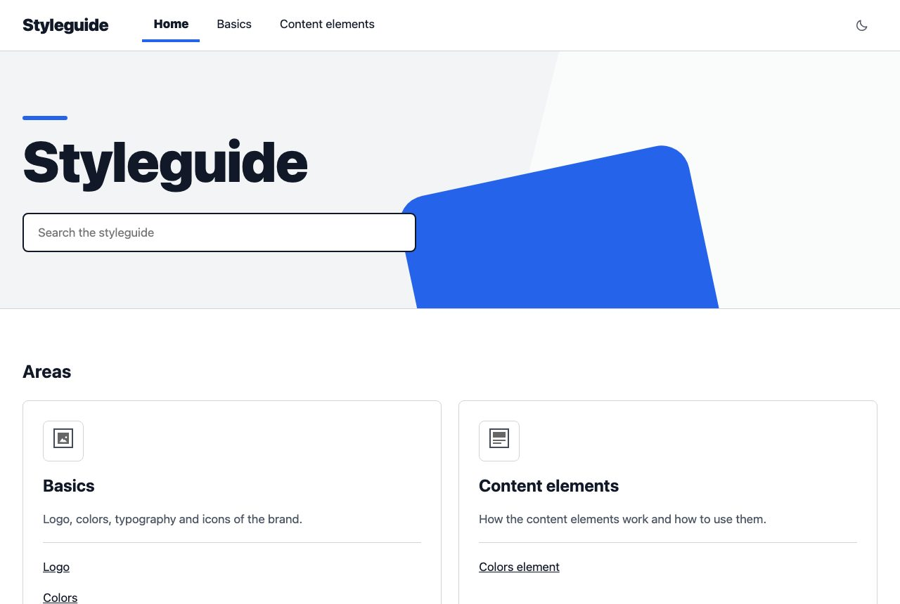

<div align="center">


# TYPO3 extension `typo3_styleguide`

[](https://packagist.org/packages/move-elevator/typo3-styleguide)
[](https://github.com/move-elevator/typo3-styleguide/actions/workflows/cgl.yml)
[](LICENSE.md)

</div>

A styleguide that lives in the TYPO3 site it describes stays current, because editors maintain it where they maintain the site. This extension provides small reusable helpers for it: content elements for colors, fonts, icons, images and usage rules, live documentation of your own content elements, a page type with a backend layout, and an optional frame with header and side menu. It is a best practice for building and maintaining an editorial styleguide, not a finished brand portal.



## ✨ Features

- [**Content elements**](Documentation/ContentElement.md): colors, fonts, icons, images, gallery, page links and Do and Don't guidelines, each with a backend preview
- [**Element documentation**](Documentation/ContentElement.md#element-documentation): the fields of any content element, read from the TCA, with live examples in preview frames
- [**Page preview**](Documentation/ContentElement.md#page-preview): shows a page of your site inside the styleguide
- [**Table of contents**](Documentation/ContentElement.md#table-of-contents): child pages as list, cards or areas, with a depth per element
- [**Technical headline**](Documentation/ContentElement.md#technical-headline): headings with an automatic table of contents for the page
- [**Page type and backend layout**](Documentation/PageType.md): styleguide pages with restricted content element availability
- [**Frame**](Documentation/Frame.md): optional header, breadcrumb, side menu and dark mode
- [**Backend-only access**](Documentation/BackendUserOnlyAccess.md): optional restriction of the frontend to logged-in backend users
- [**ViewHelpers**](Documentation/ViewHelpers/CLASSES.md): contrast, color, file and slug helpers for your own templates

## 🔥 Installation

### Requirements

- TYPO3 12, 13 or 14
- PHP 8.2 to 8.5

### Composer

[](https://packagist.org/packages/move-elevator/typo3-styleguide)


```bash
composer require move-elevator/typo3-styleguide
```

## 🚀 Quick start

Include the static TypoScript template in the backend, or import it in your site package:

```typoscript
@import 'EXT:typo3_styleguide/Configuration/TypoScript/setup.typoscript'
```

Create a page with the Styleguide page type. The New Content Element wizard now offers the styleguide elements on a **Styleguide** tab.

## 📚 Documentation

| Topic | What's inside |
|-------|---------------|
| [Content Elements](Documentation/ContentElement.md) | Every element with its fields and layouts |
| [Frame](Documentation/Frame.md) | Static template and site set, settings, side menu, dark mode, styling |
| [Page Type](Documentation/PageType.md) | The Styleguide page type and what it hides |
| [Backend Layout](Documentation/BackendLayout.md) | The layout and its content element restrictions |
| [Backend-only access](Documentation/BackendUserOnlyAccess.md) | Restricting the frontend to backend users |
| [ViewHelpers](Documentation/ViewHelpers/CLASSES.md) | Usage of every ViewHelper |

## 🧑‍💻 Contributing

Please have a look at [`CONTRIBUTING.md`](CONTRIBUTING.md).

## ⭐ License

This project is licensed under [GNU General Public License 2.0 (or later)](LICENSE.md).
